  &nbsp;
  

  I design and build <b>web apps, Android apps, APIs and bots</b> for businesses — from the first call to launch and support.

  &nbsp;
  &nbsp;
  

## ✦ What I build

## ✦ Selected work

<table>
  <tr>
    <td width="50%" valign="top">
      
      <h3>DentalClinic</h3>
      COMMERCIAL · WEB PLATFORM
      
Booking, patient portal, CRM/admin panel, booking bot and an AI consultant in 5 languages.

      <code>ASP.NET Core</code> <code>EF Core</code> <code>SQL Server</code> <code>SignalR</code> <code>Docker</code>
      

        
        
      

    </td>
    <td width="50%" valign="top">
      
      <h3> Bloom</h3>
      COMMERCIAL · PRIVATE ANDROID APP
      
Calm learning app for a children’s development academy — English, Arabic and French, voice, access by activation code.

      <code>Kotlin</code> <code>Android</code> <code>Text-to-Speech</code> <code>RTL</code>
      

        
      

    </td>
  </tr>
  <tr>
    <td width="50%" valign="top">
      
      <h3>Smart Route Planner</h3>
      PWA · ALGORITHMS · ML
      
Multi-stop routes on real roads, 2-opt optimisation, and an MLP + K-Means written from scratch. 132 tests.

      <code>PHP</code> <code>JavaScript</code> <code>OSRM</code> <code>MapLibre</code> <code>Playwright</code>
      

        
        
      

    </td>
    <td width="50%" valign="top">
      
      <h3>FleetManagement</h3>
      DESKTOP · .NET
      
CarNinja — role-based app for a vehicle fleet, drivers and routes, with UML docs and tests.

      <code>C#</code> <code>WPF</code> <code>EF6</code> <code>SQL Server</code> <code>MSTest</code>
      

        
      

    </td>
  </tr>
</table>

## ✦ Toolbox

  

 

