  &nbsp;
  

  Разрабатываю <b>веб-приложения, Android-приложения, API и ботов</b> для бизнеса — от первого созвона до запуска и поддержки.

  &nbsp;
  &nbsp;
  

## ✦ Что я делаю

## ✦ Избранные работы

<table>
  <tr>
    <td width="50%" valign="top">
      
      <h3>DentalClinic</h3>
      КОММЕРЧЕСКИЙ · ВЕБ-ПЛАТФОРМА
      
Онлайн-запись, кабинет пациента, CRM/админка, бот для записи и AI-консультант на 5 языках.

      <code>ASP.NET Core</code> <code>EF Core</code> <code>SQL Server</code> <code>SignalR</code> <code>Docker</code>
      

        
        
      

    </td>
    <td width="50%" valign="top">
      
      <h3> Bloom</h3>
      КОММЕРЧЕСКИЙ · ЗАКРЫТОЕ ANDROID-ПРИЛОЖЕНИЕ
      
Спокойное приложение для детской академии развития — английский, арабский и французский, озвучка, доступ по коду активации.

      <code>Kotlin</code> <code>Android</code> <code>Text-to-Speech</code> <code>RTL</code>
      

        
      

    </td>
  </tr>
  <tr>
    <td width="50%" valign="top">
      
      <h3>Smart Route Planner</h3>
      PWA · АЛГОРИТМЫ · ML
      
Маршруты с остановками по реальным дорогам, оптимизация 2-opt, MLP и K-Means с нуля. 132 теста.

      <code>PHP</code> <code>JavaScript</code> <code>OSRM</code> <code>MapLibre</code> <code>Playwright</code>
      

        
        
      

    </td>
    <td width="50%" valign="top">
      
      <h3>FleetManagement</h3>
      DESKTOP · .NET
      
CarNinja — приложение с ролями для автопарка, водителей и рейсов, с UML-документацией и тестами.

      <code>C#</code> <code>WPF</code> <code>EF6</code> <code>SQL Server</code> <code>MSTest</code>
      

        
      

    </td>
  </tr>
</table>

## ✦ Стек

  

 

